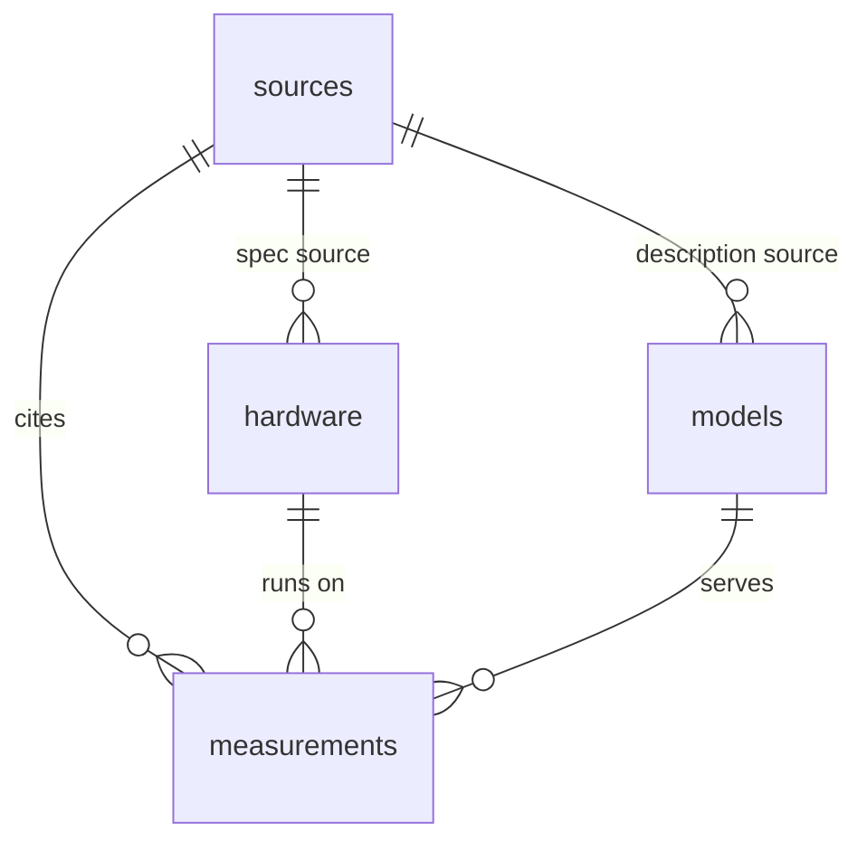

# inference-data

Open, sourced measurements of LLM inference. One row is one published result: a model, on a device, at a concurrency, with the throughput, latency, or power the source actually stated. Hardware, models, and sources live in their own tables and join on stable string ids.

Empty cell means unknown. A range, a lower bound, or a figure that only exists in a private note is left empty and explained in `notes`. Roofline arithmetic (bandwidth divided by a weight footprint, peak FLOPs divided by a parameter count) is `evidence = derived`, not a measurement.

Data is [CC BY 4.0](LICENSE-DATA). Code is [MIT](LICENSE).

## Tables



| File | One row is |
| --- | --- |
| `data/sources.csv` | A public page, post, or video: URL, author, publisher, dates, type |
| `data/hardware.csv` | A device: memory, bandwidth, dense 16-bit TFLOPS, FP4 TFLOPS, watts, prices |
| `data/models.csv` | A checkpoint: total and active parameters, architecture, license |
| `data/measurements.csv` | One result: device count, quant, engine, token lengths, concurrency, prefill and decode tok/s, TTFT, power, task time, cache state, evidence |

`datapackage.json` is a [Frictionless Data Package](https://specs.frictionlessdata.io/data-package/) with types, units, and foreign keys. `data/json/` is the same tables as JSON. `data/agentic/` holds two raw agentic benchmark tables (self-timed cloud agents, Claude Code on a box) that feed the site's Agentic tab; they are in the package but are not sourced measurements. Column units are in the name (`decode_tok_s`, `ttft_ms`, `bandwidth_gb_s`) and in the package field descriptions.

`source_type` is `benchmark`, `vendor`, `video`, or `post`.

`evidence` is:

| Value | Meaning |
| --- | --- |
| `measured_by_source` | The cited page reports a measurement it ran or a chart label from a measurement |
| `vendor_claim` | The vendor published the number (a spec-sheet benchmark or an official perf table) |
| `unverified_claim` | A public claim whose hardware, method, or text could not be checked |
| `derived` | Computed here from a spec (a roofline). Not something a timer recorded |

Per-user decode is filled only when the source printed it. Dividing an aggregate by concurrency is not stored as if it had been measured.

Cache columns, all optional:

| Column | Meaning |
| --- | --- |
| `cache_state` | `warm` (prefix or KV hit), `cold` (miss or cache off), `uncached` (prompt processing with cache off or unused), `mixed` (one figure that combines hits and misses). Empty when the source did not separate them. |
| `cache_setup` | Prefix cache, RAM or disk tier, or the engine flags the source named. |
| `spec_decoding` | Speculative method when stated (MTP, DSpark, DFlash2). |
| `kv_pool_tokens` | KV pool capacity in tokens. |
| `cache_hit_ratio` | Fraction of prompt tokens served from cache, from 0 to 1. A stated 99% is stored as 0.99. A range is left empty. A recompute percentage is not inverted into a hit rate. |
| `cached_input_tokens`, `uncached_input_tokens` | Token counts the source reported as cache reads or uncached prompt tokens. Notes say when a count is a cumulative counter rather than one request. |

`ttft_ms` is warm or cold according to `cache_state`. `prefill_tok_s` with `cache_state` `uncached` is uncached prompt processing. A researcher total marked as calculated is not stored.

## Quick start

```python
import pandas as pd

df = pd.read_csv(
    "https://raw.githubusercontent.com/knoel99/inference-data/main/data/measurements.csv"
)
```

A small loader joins the four tables. `pandas` is the only dependency.

```python
from inference_data import load

df = load()
# hardware_*, model_*, and source_* columns are attached to each measurement
df[["hardware_id", "model_id", "concurrency", "decode_tok_s", "evidence", "source_url"]].head()
```

`load()` reads `https://raw.githubusercontent.com/knoel99/inference-data/main/data/` unless you pass `base` or set `INFERENCE_DATA_BASE` to a local `data/` directory or another URL prefix. `load(joined=False)` returns the four frames separately.

```bash
python scripts/validate.py
python examples/quickstart.py
```

## Explorer

[knoel99.github.io/inference-data](https://knoel99.github.io/inference-data/) has two tabs. **Hardware specs** puts memory, bandwidth, and compute against price and power, per GPU and per computer, with diagonals of constant price per unit or units per watt, then shows what each buys: the best open model that fits, single-user generation against bandwidth, prefill against compute. Color is the brand and shape the family. Its charts read the compiled tables in `data/atlas/` (see its README: unverified, no per-row URL); its Data sub-tab lists them next to the sourced `hardware.csv`. **Inference** is one searchable, sortable table of `measurements.csv` with a CSV download. Views are linkable by hash, for example `#bandwidth` or `#inference-data`.

The page is `site/`, a static page with no build step that reads the same CSVs and `datapackage.json`. `.github/workflows/pages.yml` validates the data, assembles `_site/` with `scripts/build_site.py`, and deploys it on every push to `main`. To preview locally:

```bash
python scripts/build_site.py && python -m http.server -d _site
```

## Add a row

1. Add a `sources.csv` row if the URL is new. `url` and `date_accessed` (`YYYY-MM-DD`) are required. `source_type` is one of the four values above. The page must be public.
2. Reuse `hardware_id` and `model_id` when they already exist. Add a hardware or model row only for a device or checkpoint that is not there yet. Leave spec fields empty when the page does not state them.
3. Add one `measurements.csv` row per result. `measurement_id` is a new lowercase slug. `notes` says what was ambiguous, approximate, or left empty.
4. Do not invent a token rate, a price, or a parameter count. Do not turn a range into its midpoint. Mark rooflines `derived` and say the formula in `notes`.
5. Run `python scripts/validate.py`. If you refresh `data/json/`, run `python scripts/export_json.py` and `python scripts/export_json.py --check`.

`AGENTS.md` and `llms.txt` are the short version of this contract for agents.
